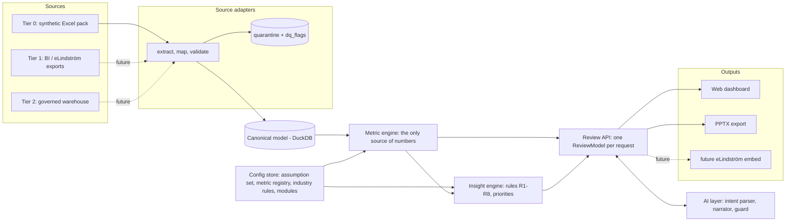
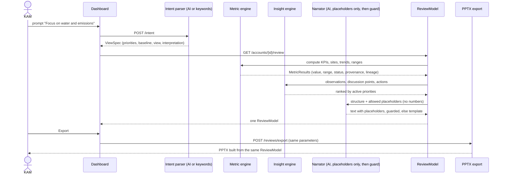
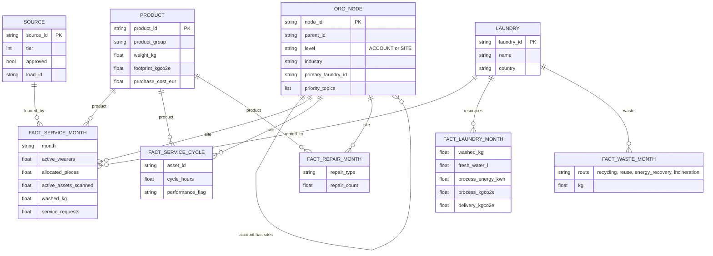

# Architecture

Three diagrams: layered overview, request flow, canonical data model. They render in any Mermaid-capable viewer (GitHub, VS Code).

## 1. Layered overview

## 2. Request flow

## 3. Canonical data model

Every fact row also carries `method_status`, `provenance`, `source_id` and `load_id`. Two further tables, `quarantine` (rejected rows with reasons) and `dq_flags` (WARNING-level consistency findings), sit beside the model.

## Notes

- The pack has no delivery-customer level, so sites hang directly under the account.
- Allocation of laundry resources to customers happens in `metrics/frames.py` (per kg), not in the stored tables.
- Spec items not built: PDF export, the Q&A agent, authentication, real source connections.
